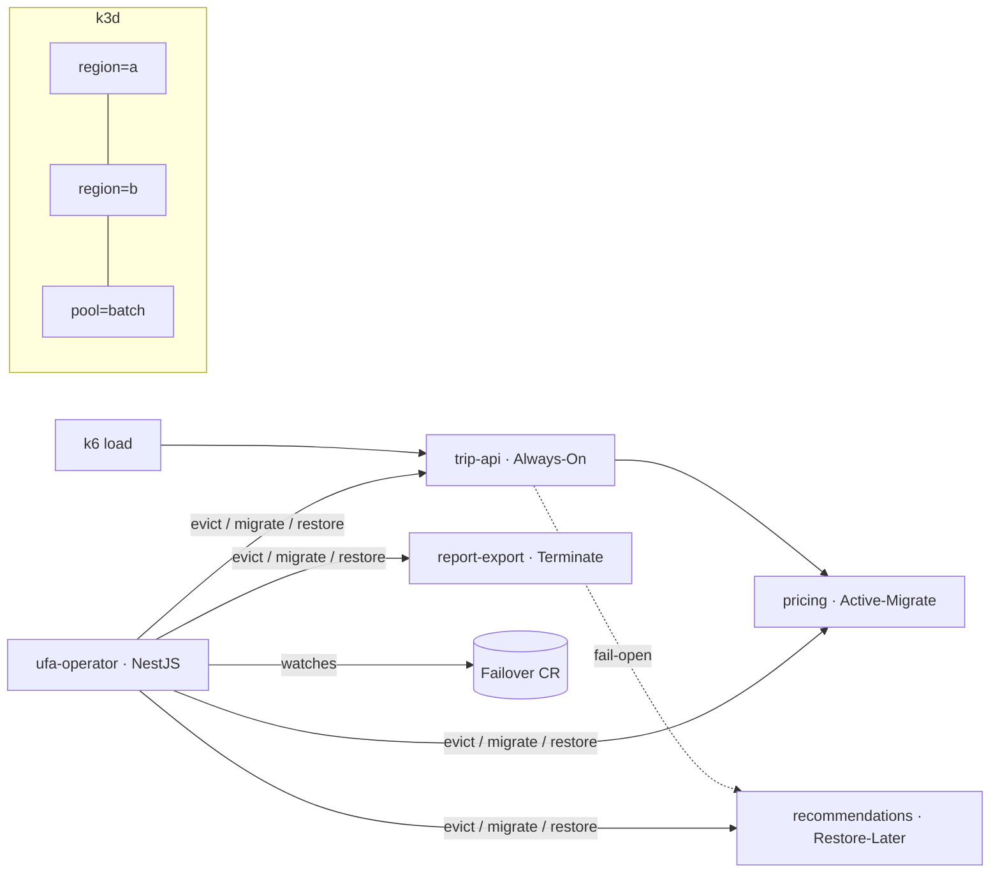

# mini-UFA — differentiated failover on Kubernetes

A laptop-scale reproduction of **Uber's Failover Architecture (UFA)** ([Bansal et al., NSDI '26](https://www.usenix.org/conference/nsdi26/presentation/bansal)).

Uber kept every service provisioned at **2× capacity** so either region could take all traffic, leaving half the fleet idle. UFA ranks services by business criticality, lets non-critical ones run in the failover headroom of critical ones, and evicts and restores them when a region fails. Uber went from 2× to 1.3× while keeping 99.97% availability.

This project rebuilds that idea with a NestJS operator on a local k3d cluster and measures the same trade-off.

## Failure classes

| Class | On failover | Recovery |
|---|---|---|
| **Always-On** | scales up in place | seconds |
| **Active-Migrate** | moved to burst capacity, make-before-break | seconds |
| **Restore-Later** | stopped, restored on batch or cloud capacity | within the RTO |
| **Terminate** | stopped until failback | none |

## Architecture



## Progress

| Phase | Scope | Status |
|---|---|---|
| 0 | Environment: k3d (6 nodes), Prometheus/Grafana, k6 | 🚧 |
| 1 | Four NestJS services, 2× baseline | ⏳ |
| 2 | PriorityClasses and overcommit with extended resources | ⏳ |
| 3 | Fail-open dependencies and blackhole drills | ⏳ |
| 4 | Operator: failover | ⏳ |
| 5 | Operator: failback and peak detection | ⏳ |
| 6 | Cloud burst (optional) | ⏳ |
| 7 | 2× vs 1.3× measurement report (optional) | ⏳ |

Each phase lands as a pull request and a tag (`v0.N.0`). Decisions and lessons per phase live in [`docs/`](docs/).

## Run it

Requires Docker, [k3d](https://k3d.io), kubectl and helm.

```bash
make up        # cluster + monitoring + placeholder workload
make status    # nodes by region/pool and pods
make load      # 5 minutes of k6 load inside the cluster
make grafana   # http://localhost:3000 (admin / mini-ufa), dashboard "mini-UFA · Capacidade"
make down
```

## Layout

```
apps/        NestJS monorepo (phase 1+)
deploy/      k3d config, monitoring values, manifests
drills/      k6 scripts and failover drills
dashboards/  Grafana dashboards
docs/        per-phase notes and the paper mapping
```

## License

MIT
